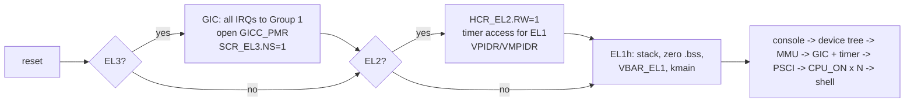

# aarch64-bringup

A bare-metal platform bring-up kernel for 64-bit Arm (AArch64), written in C and
assembly with no OS or libraries underneath. It runs on QEMU's `virt` board and
performs the same sequence the first software on a new Arm SoC has to: enter at
whatever exception level the hardware hands over, get a console up, discover the
hardware from the device tree, turn on the MMU and caches, bring up the interrupt
controller and timer, start the secondary cores through firmware, and provide a
debug monitor for poking at the result.

Everything is verified by an automated test suite that boots the kernel under four
QEMU configurations (entry at EL1, EL2 and EL3; Cortex-A53/A57/A72; 1 or 4 cores;
128 MiB or 1 GiB) and drives the shell over the serial port, plus a scripted GDB
session. CI runs it on every push.

```
aarch64-bringup v0.1.0 (board: qemu-virt)
[    0.002986] Entered at EL1, running at EL1
[    0.006617] Device tree at 0x40000000 (1048576 bytes): linux,dummy-virt
[    0.007450] UART: PL011 at 0x09000000, clock 24000000 Hz, part 0x011 rev 1, PrimeCell ID OK
[    0.008160] CPUs in device tree: 4, PSCI conduit: hvc
[    0.008885] RAM: 0x40000000 - 0x47ffffff (128 MiB) -> Normal, write-back
[    0.009552] MMIO: 0x00000000 - 0x3fffffff -> Device-nGnRE, execute-never
[    0.010290] MMU on: 39-bit VA, 4 KiB granule, 2 translation table(s), caches enabled
[    0.011376] GICv2: distributor 0x08000000, CPU interface 0x08010000, 288 lines, IIDR 0x0000043b
[    0.012281] Interrupts on: timer IRQ 27 at 100 Hz (counter 62500000 Hz), UART RX IRQ 33
[    0.012898] PSCI v1.1 via hvc
[    0.013744] CPU1 online: MPIDR=0x1, EL1
[    0.014122] CPU2 online: MPIDR=0x2, EL1
[    0.014399] CPU3 online: MPIDR=0x3, EL1
[    0.014553] Bring-up complete: 4/4 CPUs online

Type 'help' for commands.
bringup>
```

## Quick start

On Ubuntu or WSL2:

```sh
sudo apt install gcc-aarch64-linux-gnu qemu-system-arm gdb-multiarch make python3
make            # build/kernel.elf
make run        # boot, entering at EL1   (quit: Ctrl-A then X)
make run-el2    # boot, entering at EL2   (virtualization extensions)
make run-el3    # boot, entering at EL3   (security extensions)
make test       # full automated suite
```

No Arm hardware is needed. `make CPU=cortex-a72 SMP=2 MEM=1G run` changes the
emulated machine; the kernel adapts because it reads the device tree.

## Boot sequence



| Stage | What happens | Where |
|---|---|---|
| Entry | Detects `CurrentEL` and drops EL3 -> EL2 -> EL1 with `eret`, configuring `SCR_EL3`, `HCR_EL2`, `CNTHCTL_EL2` and `SCTLR_EL1` on the way. Non-boot cores park. | `arch/aarch64/start.S` |
| Early console | PL011 programmed from its reference clock (16.6 fixed-point baud divisor). Identity verified via the PrimeCell ID registers. | `drivers/pl011.c` |
| Discovery | Walks the flattened device tree: RAM, CPUs (MPIDRs), UART (address, IRQ, clock via phandle), GIC, timer PPI, PSCI conduit. Board defaults are fallbacks only. | `lib/fdt.c`, `kernel/platform.c` |
| Exceptions | 16-entry vector table, full register frame, ESR decode (exception class, fault status code, level, read/write, FAR). Expected faults are recovered by skipping the instruction. | `arch/aarch64/vectors.S`, `exceptions.c` |
| MMU | Identity map, 4 KiB granule, 39-bit VA: 1 GiB blocks where possible, split into 2 MiB blocks when attributes differ. RAM Normal write-back inner-shareable, MMIO Device-nGnRE execute-never. MAIR/TCR/TTBR0, TLB and I-cache invalidate, then `SCTLR_EL1.{M,C,I}`. | `arch/aarch64/mmu.c` |
| Interrupts | GICv2 distributor + banked per-CPU interface. EL1 virtual timer tick driven by advancing `CNTV_CVAL_EL0` (no drift). UART receive is interrupt-driven into a lock-free ring buffer; the idle shell sleeps in WFI. | `drivers/gicv2.c`, `timer.c`, `pl011.c` |
| Firmware | PSCI over HVC or SMC (from the device tree) per the SMC Calling Convention: version, CPU_ON, SYSTEM_OFF, SYSTEM_RESET. | `arch/aarch64/psci.c` |
| SMP | `CPU_ON` for each core in the device tree; each turns on its MMU with the shared tables, initializes its GIC interface and checks in. Work is dispatched by SGI (inter-processor interrupt). | `kernel/smp.c` |
| Monitor | UART shell for inspecting and exercising all of the above. | `kernel/shell.c` |

## Debug shell

| Command | Purpose |
|---|---|
| `info` | CPU (decoded MIDR), exception levels, MMU/cache state, cache line sizes, memory map, peripherals, PSCI version |
| `dt` | Print the device tree |
| `md <addr> [n]` / `mw <addr> <val>` | Read/write 32-bit words; aborts are caught, so probing unknown addresses is safe |
| `pt <va>` | Hardware address translation (`AT S1E1R` -> `PAR_EL1`): PA and memory type, or fault and level |
| `irqs` | Per-interrupt counts |
| `uptime` | Generic timer uptime and tick count |
| `smp [n]` | All cores increment a shared counter under a spinlock (must be exact), then an IPI round trip to each core |
| `race [n]` | The same counter without the lock, to show lost updates |
| `fault`, `svc`, `undef` | Take a data abort, supervisor call or undefined instruction and recover |
| `crash` | Unrecoverable abort: decoded fault, full register dump, halt |
| `reset`, `poweroff` | PSCI SYSTEM_RESET / SYSTEM_OFF |

```
bringup> pt 0x09000000
VA 0x0000000009000000 -> PA 0x0000000009000000  attr 0x04 (Device-nGnRE)
bringup> md 0x09000fe0 8
09000fe0: 00000011 00000010 00000014 00000000
09000ff0: 0000000d 000000f0 00000005 000000b1
bringup> fault
reading 0x4000000000...
Synchronous exception on CPU0:
  Data abort (current EL) (EC=0x25, ESR=0x96000005)
  cause: translation fault, level 1
  access: read
  FAR: 0x0000004000000000
  ELR: 0x0000000040200804
  recovered: skipping faulting instruction
bringup> smp
CPUs online: 4/4
spinlock test: 400000/400000 increments across 4 CPUs (OK) in 89807 us
IPI test: 3/3 CPUs answered SGI 1
bringup> race
unlocked increments: 303977/400000 across 4 CPUs, 96023 lost updates
```

The `md` output above is the PL011's PrimeCell ID block: part number `0x011`,
designer `0x41` (Arm), and the component ID `0xB105F00D`.

## Testing

`make test` runs `tests/run_tests.py`, which starts QEMU with the serial port on a
pipe and checks, for each configuration:

- boots to the shell with the expected number of cores online
- reports the correct entry EL, CPU model (from `MIDR_EL1`) and RAM size (from the device tree)
- MMU and caches on; `AT S1E1R` shows RAM as Normal, MMIO as Device, holes unmapped
- PrimeCell ID registers read back correctly
- data abort, SVC and undefined instruction are decoded and recovered
- timer interrupts arrive at the programmed rate; UART RX arrives through the GIC
- spinlock counter is exact across all cores; every secondary answers an IPI
- PSCI SYSTEM_OFF exits QEMU (or is correctly unavailable after EL3 entry)

plus an unrecoverable-crash test and a GDB session that checks the reset entry
point, the boot EL passed to `kmain`, and a breakpoint hit on a PSCI-started core.
78 checks, about 6 seconds. Serial logs go to `build/test-logs/`.

| Config | Machine | Entry | CPU | Cores | RAM |
|---|---|---|---|---|---|
| `el1-a53` | `virt` | EL1 | Cortex-A53 | 4 | 128 MiB |
| `el2-a72` | `virt,virtualization=on` | EL2 | Cortex-A72 | 4 | 128 MiB |
| `el3-a53` | `virt,secure=on` | EL3 | Cortex-A53 | 4 (1 used: no PSCI) | 128 MiB |
| `el1-a57-1c` | `virt` | EL1 | Cortex-A57 | 1 | 1 GiB |

## Debugging with GDB

```sh
make debug      # terminal 1: QEMU halted at the first instruction
make gdb        # terminal 2: attaches, breakpoints on kmain/secondary_main
```

Each emulated core shows up as a GDB thread (`info threads`).

## Bugs found during bring-up

Three issues came up while getting this working; each is the kind of thing that
shows up on real hardware too.

1. **No device tree on first boot.** The kernel found no DTB at the start of RAM.
   QEMU only places the DTB below a bare ELF image if it fits, and the `virt` DTB
   is 1 MiB while the image was linked 512 KiB into RAM. Moving the load address
   to 2 MiB fixed it. Lesson: the boot protocol between loader and image is part
   of the platform contract.
2. **No interrupts after EL3 entry.** With `secure=on` the system booted but no
   IRQ was ever taken (confirmed with `qemu -d int`). `GICC_PMR` resets to 0, and
   GICv2 ignores non-secure writes to PMR while it holds a secure-range value, so
   EL1's priority mask silently never took effect. The EL3 path now opens PMR
   from the secure side, as TF-A would.
3. **Serial input stalled under fast typing (EL2 config only).** The UART IRQ
   handler drained the FIFO and then cleared the interrupt. A byte arriving in
   between had its interrupt cleared while it sat in the FIFO, and QEMU's PL011
   only raises RX on the empty-to-non-empty transition, so input stopped for good.
   Clearing before draining fixed it. The test suite caught it; manual testing
   had not.

## Design notes

- **Logical CPU ID in `TPIDR_EL1`**, set at entry, so per-CPU data never depends
  on how a given SoC encodes MPIDR affinity.
- **`-mstrict-align` and `-mgeneral-regs-only`**: until the MMU is on, all data
  accesses are Device memory, where unaligned accesses fault; and the kernel never
  touches FP/SIMD state.
- **No console lock before the MMU is on**: exclusive load/store is only
  guaranteed on Normal memory. Only the boot CPU runs at that point.
- **Secondaries take no memory reads before their MMU is on**: their stack is
  computed from the logical index passed in the PSCI context ID, so stale data in
  the boot CPU's cache cannot hurt them.
- **Mask-check-WFI** in the UART read path: a pending interrupt still wakes WFI
  while IRQs are masked, so a byte cannot slip in between the check and the sleep.

## Layout

```
arch/aarch64/   start.S (EL entry/drop), vectors.S, exceptions.c, mmu.c, psci.c
drivers/        pl011.c, gicv2.c, timer.c
lib/            fdt.c (device tree parser), kprintf.c, string.c
kernel/         main.c (boot sequence), platform.c (discovery), smp.c, shell.c
board/qemu_virt board.h: fallback addresses and load address
tests/          run_tests.py (QEMU + GDB test harness)
```

## Porting

Hardware addresses come from the device tree at runtime. A new board needs
`board/<name>/board.h` (load address, early-console UART, fallbacks) and
`make BOARD=<name>`. Drivers exist for PL011 and GICv2 (GIC-400); a board with a
different UART or a GICv3 needs a driver for it (the kernel detects GICv3 and
falls back to a polled console without interrupts).

## Limitations

- Tested on QEMU only; not run on physical hardware.
- GICv2 only. No GICv3/GICv4.
- Identity mapping at 2 MiB granularity; no separate permissions for kernel text
  and data (no W^X).
- At EL3 there is no resident PSCI implementation, so EL3 entry runs single-core.
- The device tree parser decodes `reg` with up to two address and size cells and
  GIC-format interrupt specifiers.

## References

- Arm Architecture Reference Manual for A-profile (DDI 0487): exception model, ESR, MMU, generic timer
- Arm GIC Architecture Specification v1/v2 (IHI 0048B)
- PrimeCell UART (PL011) Technical Reference Manual (DDI 0183)
- Arm Power State Coordination Interface (DEN 0022) and SMC Calling Convention (DEN 0028)
- Devicetree Specification v0.4
